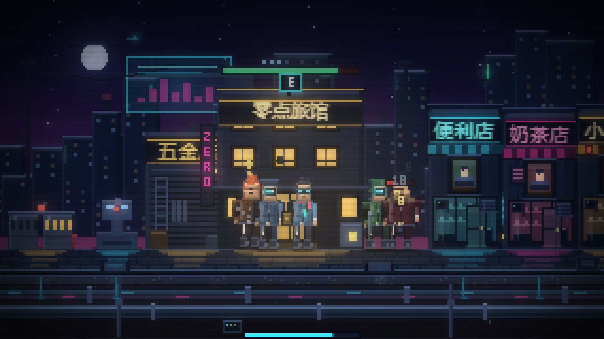

# 零点霓虹 · Zero Neon

横屏像素 · 白天经营，夜里守街。

**在线游玩**：https://djjdjd23.github.io/zero-neon/

手机浏览器打开即玩，**请横屏**。



---

## 玩法

- **◀ ▶** 移动 · **E** 交互
- 走到**五金店**下单 → 走到空位按 **E** 放置 → 施工队自动来建
- 商店赚的钱记在**店头**（屋顶有金额牌），**走近就自动收进钱包**
- 保安会和敌人**正面互殴**：敌人贴到保安就停下对打，不再绕过去砸店
- 走进店里招**店员**（一个店员占一个二层窗口，收入 +35%）
- 库存卖光要走到店前按 **E** 补货
- 夜里敌人来砸店，**你打不了人**，只能跑动调度
- **黄昏**会给出今晚第一波的情报（方向 / 数量 / 种类），并弹出**布防**面板
- 右上角 **II** 按钮暂停（再点继续）；缺货的店屋顶会亮**红色感叹号**
- 顶部横栏的 **「招募 · …」** 会轮播下一位特殊 NPC 的**招募条件与进度**，点开可看全部八位
- 右上 **「街史」** 是剧情档案（五幕 + 四个结局），**不看也能照常玩**
- 点击面板外的任意位置即可关闭面板
- **唯一失败条件：威望归零**

## 时间

| 阶段 | 时长 | 倍速 |
|---|---|---|
| 白天 | 200 秒 | 1× / 2× / 4× |
| 黄昏 | 45 秒 | 1× / 2× / 4× / 跳过 |
| 夜晚 | 150 秒 | 1× / 2× / 4× |

夜晚也可以加速（v0.3 起）：节奏交给你自己，2×/4× 会同时加快敌人、炮塔、保安与波次间隔。

---

## 内容清单

### 七种商店

| 商店 | 造价 | 耗电 | 日库存 / 补货 | 特点 |
|---|---|---|---|---|
| 便利店 | 200 | 2kW | 40 / 8s | 基础稳定收入 |
| 奶茶店 | 320 | 2kW | 30 / 5s | 客单价高 |
| 小饭馆 | 420 | 3kW | 36 / 10s | 只白天营业 |
| 旅馆 | 520 | 2kW | 24 / 12s | **夜间也赚钱** |
| 网吧 | 640 | 4kW | ∞ / 无需补货 | 昼夜营业 |
| 药房 | 600 | 2kW | — | 保安血量上限 +10%/级 |
| 当铺 | 380 | 1kW | — | 卖掉落物 + 贷款 |

商店按天数解锁：便利店/奶茶店/当铺第 1 天，小饭馆第 2 天，旅馆/网吧第 8 天，药房第 15 天。

### 五种防御设施

路障（挡路）· 地刺（踩踏伤害）· 摄像头（炮塔射程 +40%，带扫描光锥）· 电击门（接触伤害 + 眩晕，有电弧特效）· 炮塔（主力输出）

### 七种敌人

小偷 → 砸店党（第 4 天）→ 飞车党（第 8 天，悬浮机车）→ 黑帮（第 15 天）→ 内鬼（第 22 天）→ 赛博改造人（第 30 天）→ 清街队队长（第 35 天，精英）

| 敌人 | 血量 | 每次伤害 | 出现 |
|---|---|---|---|
| 小偷 | 20 | 4 | 第 1 天 |
| 砸店党 | 40 | 8 | 第 4 天 |
| 飞车党 | 30 | 6 | 第 8 天 |
| 黑帮 | 80 | 10 | 第 15 天 |
| 内鬼 | 35 | 7 | 第 22 天 |
| 赛博改造人 | 200 | 16 | 第 30 天 |
| 清街队队长 | 150 | 20 | 第 35 天 |

血量每天 +3%（按当天重算）。第一晚只有 2 波 × 2 只小偷，一名近战保安（120 血、8 伤/0.6 秒）足够守住。

**战斗规则**：敌人贴到保安就**停下互殴**，不再绕过去砸店；保安近战射程 13。敌人头顶**常显血条**（绿 >55%，黄 >28%，红），命中会飘伤害数字。

### 战斗人员

近战保安 / 远程保安 / 战斗机器人 / 店员（每个 +35% 收入，占一个窗口）

- 会**自动巡逻**（白天在自己的半条街上来回走），夜间按布防设置守左 / 守右 / 自动
- 互不碰撞：同侧多人自动左右错开站位
- 活动范围限制在**街道最外侧建筑之间**，不会跑出街
- **远程自动站在近战与机器人身后**
- 每日自动回复 35% 血量；药房提升血量上限

### 八位特殊 NPC

每位都有独立造型、门槛、任务与入队能力：

- **老周**（建造）第 4 天 · 建 3 座防御 → 拆建免费
- **阿豹**（战斗）累计击杀 30 → 近战伤害 +50%
- **老陈**（战斗）第 8 天 · 击杀 60 → 全体伤害 +25%
- **梅姐**（金融）当铺 Lv2 · 还清贷款+存款 3 万 → 金库利息 ×3
- **阿霓**（防御）有网吧+营业额 8000 → 炮塔射程 +30%
- **小雨**（经营）药房 Lv2 · 撑过 4 天 → 全街自动补货
- **小满**（经营）小饭馆 Lv2 · 单日 5000 → 客流 +50%，夜间多 1 波
- **零号**（真相）家 Lv6 + 5 人入队 · 守 40 天 → 真结局路径

### 陈晓（第四幕 NPC）

第四幕解锁后会站在街口（家右侧），走过去按 **E** 可以签字或拒绝。**只写进剧情档案，不改任何经营数值**（拒绝会 +20 威望）。

### 其他系统

- 昼夜循环 + 倍速 + 黄昏跳过 + 跨夜自动归 1×
- 随身现金 / 小金库（2%/天利息）/ 当铺贷款（日息 5%，逾期掉威望）
- 电力：每日重置、超载断电、手动优先级
- 家被破坏 → 降 1 级 / 金库 -40% / 当晚结束 / 次日 260 秒
- 掉落物 → 当铺变现
- 黄昏布防：每人可设「守左 / 自动 / 守右」，自动会跟着敌人方向
- 面板支持点击外部关闭（结算与结束面板除外）

---

## 街史（剧情）

剧情是**补充项**，不弹窗、不锁操作、不影响胜负。全部内容在右上 **「街史」** 里：

| 幕 | 解锁条件 |
|---|---|
| 第一幕 · 这条街不对劲 | 老周入队 |
| 第二幕 · 钱从哪来 | 阿豹 + 梅姐入队 |
| 第三幕 · 零号是谁 | 阿霓 + 小雨 + 老陈入队 |
| 第四幕 · 代价 | 小满入队 + 家 Lv5（陈晓出现在街上） |
| 第五幕 · 第七个雨夜 | 零号入队 |

解锁时屏幕上会出一条**不打断操作的提示条**，结算面板底部也有一行随进度变化的短句。

**结局档案**

| 结局 | 怎么来 |
|---|---|
| A · 熄灯 | 老周 + 阿霓 + 零号在队后，家右侧出现**中枢门**，玩家自己走过去按 E 才会发生（可以一辈子不按） |
| B · 体面离场 | 在陈晓那里签字 |
| C · 第七个雨夜 | 八人全部入队 + 守过 50 天 + 没签字 |
| D · 清街 | 威望归零 |

世界观：清河街要被「城市更新」。三十年前地下埋过「零号工程」——一套夜间自动保护街区的中枢。项目失败，中枢封存。零号是它唯一留下的人形接口，还在执行那条没被取消的指令。

---

## 美术

全部像素图形由代码程序化绘制，**零图片素材**，内部渲染 320×180 后整数放大。

- 人物用统一的「轮廓 → 腿 → 躯干 → 手臂 → 头」管线绘制，带双色明暗与霓虹轮廓光
- 建筑有独立立面、霓虹招牌（3×5 像素字体）、雨棚、空调外机、店内剪影
- 场景有霓虹泛光（bloom）、湿地反光、扫描线、暗角、远景视差天际线、全息广告牌、电线、路灯锥、蒸汽

**全部单位与建筑的立绘图集**：[gallery.html](gallery.html)

| 图集 | 内容 |
|---|---|
| [preview/01-npc.png](preview/01-npc.png) | 八位特殊 NPC + 陈晓 |
| [preview/02-enemy.png](preview/02-enemy.png) | 七种敌人 |
| [preview/03-shop.png](preview/03-shop.png) | 七种商店建筑 |
| [preview/04-defense.png](preview/04-defense.png) | 五种防御设施 |
| [preview/05-fighter.png](preview/05-fighter.png) | 战斗人员与店员 |

---

## 本地运行

直接用浏览器打开 `index.html`，无需构建、无需服务器。

调试参数：

- `?demo` — 直接进入已开工的街景
- `?demo&night` — 夜晚战斗场景
- `?demo&menu` — 打开建造菜单

## 测试

```bash
node test/smoke.js
```

用 stub DOM/Canvas 跑真实脚本，覆盖建造、补货、战斗、结算、家被破坏、威望归零、NPC 入队等路径。

## 设计文档

见 [设计大纲-v6.md](设计大纲-v6.md)（GitHub Pages 上的副本为 `design.md`）
